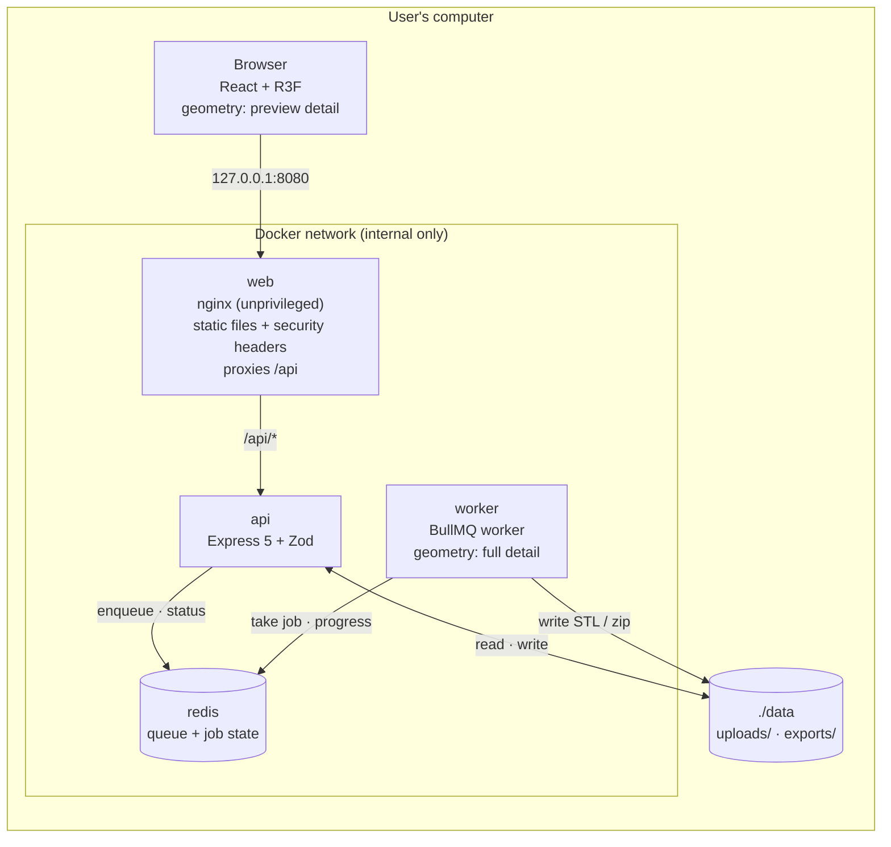
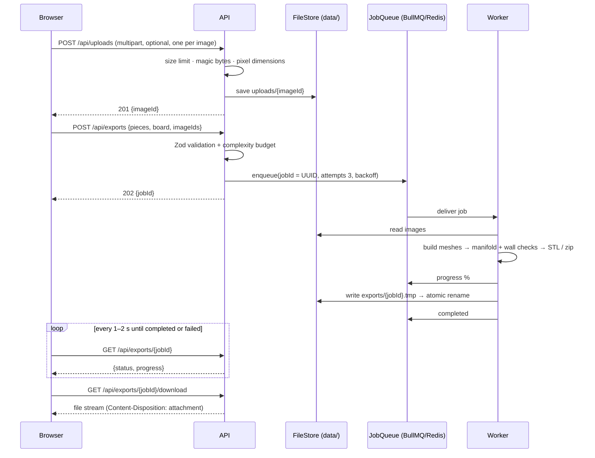
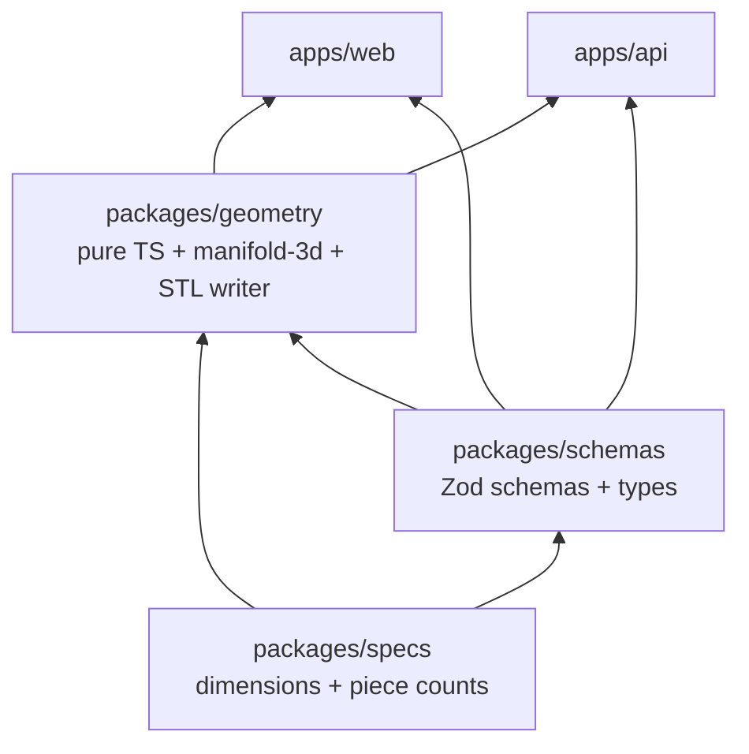
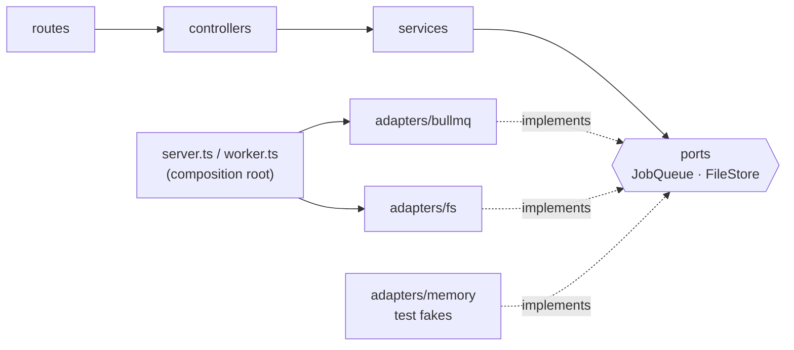
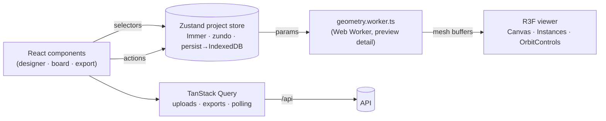
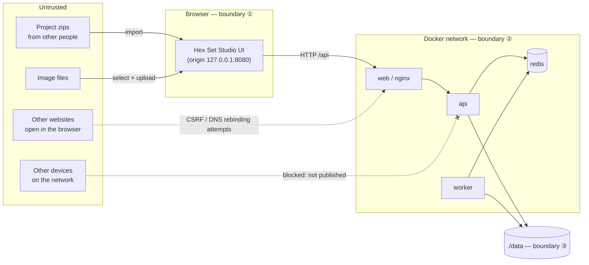
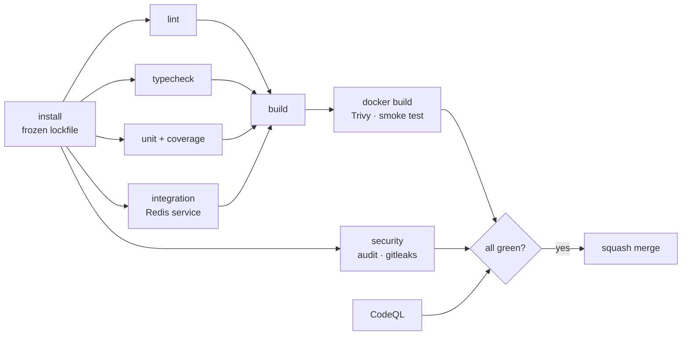

# Technical Architecture

> **Status:** this describes the target architecture for v1. It's being built in phases ([roadmap](#roadmap)).

**Contents:** [Overview](#overview) · [Runtime](#runtime) · [Export flow](#export-flow) · [Code structure](#code-structure) · [Frontend](#frontend) · [Environments](#environments) · [Invariants](#invariants) · [Design decisions](#design-decisions) · [Security](#security) · [Testing strategy](#testing-strategy) · [Roadmap](#roadmap)

Diagrams are written in Mermaid, so GitHub renders them and they're easy to change in a PR. Other images (screenshots, renders, exported diagrams) live in [`docs/images/`](docs/images/) and are referenced from here, for example ``.

## Overview

Hex Set Studio turns **design parameters** into **3D-printable STL files** for a Catan-compatible board set. It's a local app: users clone the repo and run it with Docker Compose.

```
design parameters (JSON)  ──►  geometry builders  ──►  triangle mesh  ──►  3D preview  /  STL file
{ piece: "settlement",          buildSettlement()       vertices +          (browser)     (export)
  roof: "gabled", ... }                                  triangles
```

The same geometry code builds the live preview and the exported file, so **the preview always matches the print**.

## Runtime

What `docker compose up` starts on a user's machine:



| Service | Responsibility | Published? |
|---|---|---|
| `web` | Serves the built React app; reverse-proxies `/api`; sets CSP and other headers | **Yes, `127.0.0.1:8080` only** |
| `api` | Validates requests, stores uploads, enqueues jobs, reports status, streams downloads | No |
| `worker` | Builds meshes at full detail, validates them, writes STL/zip, reports progress | No |
| `redis` | BullMQ queue and job state (`noeviction`, AOF persistence) | No |

`api` and `worker` share one image and one codebase (`apps/api`) with two entry points.

## Export flow



**Reliability properties:**
- **Idempotent enqueue:** the `jobId` is the BullMQ job ID, so a duplicate submit doesn't create duplicate work.
- **At-least-once processing:** a crashed worker's job is retried (3 attempts, exponential backoff). Exhausted jobs stay in BullMQ's failed set, which serves as the dead-letter queue.
- **Atomic output:** write to `.tmp`, then rename, so a partially written file is never served.
- **Retention:** jobs and files are removed after 24 h by BullMQ options and an hourly cleanup job scheduler.

## Code structure

### Packages



| Package | Contains | Must not contain |
|---|---|---|
| `packages/specs` | Component dimensions (mm), piece counts, expansion flags | Logic beyond constants and simple helpers |
| `packages/schemas` | Zod schemas, inferred types, OpenAPI registry, limits | I/O |
| `packages/geometry` | Pure builders `build<Piece>(params, detail)`, CSG features, validation, STL writer | DOM, React, Node I/O, Redis |
| `apps/web` | UI, viewer, stores, API client, Web Worker host | Duplicated geometry or schemas |
| `apps/api` | HTTP API, worker, ports and adapters | Geometry logic (it calls `packages/geometry`) |

### Component specs (v1: base game)

`packages/specs` is the single source of truth. All values are in mm; cardboard-equivalent pieces default to 2 mm thick.

| Component | Size | v1 |
|---|---|---|
| Terrain hex | 79 flat-to-flat × 89 point-to-point × 2 | ✅ |
| Number chit | Ø25 × 2 | ✅ |
| Trading port | 46 × 35 × 2 | ✅ |
| Road | 25 × 5 × 5 | ✅ |
| Settlement | 14 × 10 × 12 h | ✅ |
| City | 20 × 10 × 20 h | ✅ |
| Robber | Ø15 × 32 h | ✅ |
| Die | 16 cube | ✅ |
| Card | 54 × 80 × 2 | optional |
| Harbor randomizer 24×28 · bonus chit Ø15.5 · city wall 21×21×5 · knight Ø18.5×6 · ship 19×8×9.5 · merchant Ø15×25 · metropolis 29.5×8×23.5 · barbarian ship 33×10×22.5 | recorded, hidden | later |

Base-set counts: 19 hexes (4 forest, 4 pasture, 4 fields, 3 hills, 3 mountains, 1 desert), 18 chits, 9 ports, 2 dice, 1 robber, and 15 roads, 5 settlements and 4 cities per player (4 players).

### Backend layers (ports and adapters)



- **Controllers** handle HTTP only. **Services** hold the business logic and depend on **ports** (interfaces), never on adapters. A lint rule enforces this.
- `LocalFileStore` is the **only** code that touches the filesystem, and it confines every path to `DATA_DIR`.
- `app.ts` builds the Express app, `server.ts` starts it, `worker.ts` starts the BullMQ worker. Tests import `app.ts` directly.
- `config.ts` parses environment variables with Zod at startup, so misconfiguration fails fast.

### API (v1)

| Method | Path | Purpose |
|---|---|---|
| `GET` | `/api/health` | API and Redis health |
| `POST` | `/api/uploads` | Upload one image (multipart, ≤5 MB, PNG/JPEG/SVG) → `{ imageId }` |
| `POST` | `/api/exports` | Create an export job → `202 { jobId }` |
| `GET` | `/api/exports/:jobId` | `{ status, progress, error? }` |
| `GET` | `/api/exports/:jobId/download` | Stream the finished file |
| `GET` | `/api/docs` | Generated OpenAPI documentation |

## Frontend



- **Project state** (Zustand) holds design parameters and the board layout. Components subscribe through selectors, so a slider drag re-renders only what depends on it.
- **Geometry runs off the main thread** in a Web Worker, so the UI stays responsive.
- **Server state** (TanStack Query) handles uploads, export creation and status polling.
- **3D board:** R3F pointer events do the picking, `<Instances>` handles repeated parts, and the board uses **preview** level of detail.
- **Persistence:** auto-save to IndexedDB, plus manual project zip export and import. Imports are validated (see [Security](#security)).

## Environments

| | Users | Contributors |
|---|---|---|
| Start | `docker compose up` | `docker compose -f docker-compose.dev.yml up -d` + `pnpm dev` |
| Frontend | nginx on `127.0.0.1:8080` | Vite on `localhost:5173` (proxies `/api` → `:3000`) |
| API / worker | containers | `tsx watch`, reloads on save |
| Redis | internal container | container on `127.0.0.1:6379` |
| Data | `./data` volume | `./data` (configurable with `DATA_DIR`) |

## Invariants

1. **Millimeters only.** Every physical dimension comes from `packages/specs`.
2. **Geometry is pure and deterministic:** the same parameters and detail level always produce the same mesh.
3. **Validate at every trust boundary** with the shared Zod schemas: API requests, job payloads, imported projects, environment config.
4. **Only server-generated identifiers touch the filesystem.**
5. **Nothing listens beyond `127.0.0.1`.**
6. **Preview and export use the same builders**, differing only in `detail`.

## Design decisions

Every significant technical choice is recorded here: what we chose, why, and what we rejected. **To change a decision or add a new one**, update this section in the same PR as the code, and explain the reasoning in the PR description.

| Area | Decision | Why | Rejected |
|---|---|---|---|
| Language | **TypeScript everywhere** | Geometry runs in both the browser preview and the export worker. One language means one copy, so the preview always matches the print | Python backend (geometry duplicated, or a slow server-side preview) |
| Repo | **pnpm workspaces monorepo** | Links local packages; strict dependencies prevent "phantom" imports; blocks install scripts by default | npm workspaces; Turborepo/Nx (not needed yet); separate repos |
| UI | **React + Vite** | Best 3D ecosystem, component model fits the UI, fast dev loop, most transferable skills | Vue, Svelte, Next.js |
| 3D | **react-three-fiber + drei**, with a 3D board | Declarative scene driven by state, built-in picking, instancing, controls, automatic GPU cleanup | Plain three.js; a 2D SVG board |
| Geometry | **Parametric builders in mm + manifold-3d** | Designs are small JSON documents; manifold-3d guarantees watertight meshes; preview/full level of detail | Free-form editor; importing user CAD; three-bvh-csg (not guaranteed manifold) |
| API | **Express 5**, layered | The most widely used Node framework; Express 5 handles async errors; layering keeps logic testable | Hono, Fastify, NestJS, tRPC |
| Validation | **Shared Zod schemas** + generated OpenAPI | One definition gives runtime checks, TS types and API docs; the frontend and backend can't drift | Hand-written validation; JSON Schema + Ajv |
| Async jobs | **BullMQ + Redis** | Exports can be slow, so jobs are queued with retries, progress, crash recovery and scheduled cleanup | Synchronous export; in-process queue; SQS via LocalStack; Celery |
| Storage | **Local `data/` folder**, with job state in Redis | Simplest correct option for a single-user local app | DynamoDB Local, SQLite, Postgres |
| Auth | **None** | Single-user local app; nothing to protect or identify. Security comes from network and origin controls instead | Cognito, third-party auth, a local password |
| State | **Zustand** (project) + **TanStack Query** (server) + `useState` (UI) | Selective re-renders next to the 3D canvas; undo/redo and auto-save; polling handled by TanStack Query | Context for everything; Redux Toolkit |
| Styling | **Tailwind + shadcn/ui** | Accessible Radix controls, copied in so we own the code; consistent design scale | CSS Modules, MUI, Mantine |
| Distribution | **Docker Compose, local only** | Users need only Docker + Git; reproducible; no hosting cost or internet attack surface | AWS + Terraform (moved to a separate practice project); requiring Node for users; a desktop app |
| Architecture | **Ports and adapters** | Fast unit tests with fakes; path safety in one place; a future cloud move means new adapters, not a rewrite | Calling Redis/fs directly; DI frameworks |
| Testing | **Test pyramid**; geometry tested by properties | Fast feedback; tests fail only when a print would actually be wrong | Mostly E2E; mesh snapshots; WebGL screenshot tests |
| Workflow | **GitHub Flow + Conventional Commits + required CI** | `main` always works; readable history; standards enforced by machines | Git Flow; direct commits to `main` |

### How the job-queue decision evolved

A good example of constraints driving decisions:
1. **Celery** (Python) was set aside once the backend became TypeScript.
2. While the plan targeted AWS, **SQS + Lambda** won, and **BullMQ was rejected** because always-on Redis costs money in the cloud.
3. When the project became a **local app**, that cost disappeared. Redis runs for free in Docker, so BullMQ became the simplest correct choice.

| Celery concept | BullMQ equivalent |
|---|---|
| Broker | Redis |
| Worker | `Worker` in `worker.ts` |
| Result backend | Redis (job state, progress, return value) |
| Retries | `attempts` + `backoff` |
| Beat (scheduled tasks) | Job schedulers / repeatable jobs |

## Security

**Principles:** defense in depth, least privilege, secure by default, small attack surface.

**Assets we protect:**
- **the user's computer:** files outside `data/`, CPU, memory, disk
- **their designs**
- **the integrity of the code and images they run** (supply chain)

There are no accounts, no personal data and no secrets.

**Out of scope:** running the app on a public network or the internet. That's unsupported.

### Trust boundaries



- **① Browser:** imported zips and selected images are validated before use.
- **② API edge:** every request is untrusted, even from our own UI. Any website or local program can send requests to localhost.
- **③ Filesystem:** only server-generated IDs become paths, confined to `DATA_DIR`.

### Threats and mitigations (STRIDE)

| Category | Threat | Mitigation |
|---|---|---|
| Spoofing | A malicious website sends requests to the local API (**CSRF**) | `originGuard` rejects state-changing requests from a foreign `Origin`. JSON endpoints require `application/json` (forces a CORS preflight, which fails). No CORS headers are sent |
| Spoofing | **DNS rebinding** lets an attacker's page read API responses | `originGuard` rejects any `Host` other than `localhost`/`127.0.0.1` with the expected port |
| Tampering | **Path traversal** (`../../etc/passwd`) | IDs validated as UUIDs; server-generated filenames; `LocalFileStore` asserts every path stays inside `DATA_DIR` |
| Tampering | **Zip slip** or a malicious `project.json` in shared projects | Import runs in the browser with no filesystem writes; entry names allow-listed; `project.json` validated with Zod (with limits) and versioned migrations |
| Tampering | **Supply chain** (compromised packages, images or actions) | Frozen lockfile; pnpm build-script allow-list; Dependabot; `pnpm audit`; CodeQL; images pinned by digest + Trivy; actions pinned to SHAs; read-only CI permissions; branch protection |
| Repudiation | Failures are hard to trace | Structured logs with `requestId`/`jobId` (never user content); failed jobs keep their error reason |
| Info disclosure | Other devices reach the app or Redis | Only `web` is published, on `127.0.0.1`; dev Redis binds to `127.0.0.1` |
| Info disclosure | Stack traces in errors | Central error handler: generic message + `requestId`; `helmet`; `x-powered-by` off |
| Info disclosure | **XSS** through user text or SVGs | React escaping; `dangerouslySetInnerHTML` banned; user text becomes geometry, not HTML; SVGs parsed for paths only (DOMPurify for display); strict CSP |
| Info disclosure | Clickjacking | `frame-ancestors 'none'` |
| Denial of service | Expensive export requests | Zod limits on every field + a **complexity budget**; worker concurrency 2; job timeout; container memory and CPU limits |
| Denial of service | **Decompression bombs** (tiny images that decode to huge bitmaps) | Read image headers and reject over 4096 × 4096 before decoding; ≤5 MB uploads |
| Denial of service | **Zip bombs** on import | Check the central directory before extracting: ≤100 MB uncompressed, ≤500 entries, compression-ratio cap |
| Denial of service | Disk fills up | 24 h retention + hourly cleanup |
| Elevation of privilege | Container compromise | Non-root users; read-only root filesystem where possible; only `data/` writable; no Docker socket |
| Elevation of privilege | Fake file types | Magic-byte detection; allow-listed types; downloads served as attachments |

### Security headers (nginx, proposed; verify in Phase 2)

```
Content-Security-Policy:
  default-src 'self';
  script-src 'self' 'wasm-unsafe-eval';   # manifold-3d WebAssembly
  style-src 'self' 'unsafe-inline';       # Radix/R3F set inline style attributes
  img-src 'self' data: blob:;
  worker-src 'self' blob:;
  connect-src 'self';
  object-src 'none'; base-uri 'none'; form-action 'self'; frame-ancestors 'none'
X-Content-Type-Options: nosniff
Referrer-Policy: no-referrer
Permissions-Policy: camera=(), microphone=(), geolocation=()
```

HSTS isn't used, because the app is served over plain HTTP on localhost by design.

### Accepted residual risks
- Other programs on the same computer can call the API. They already have the user's privileges, so the app adds nothing new.
- A user deliberately exposes the app beyond localhost. That's unsupported and documented.
- `style-src 'unsafe-inline'` is required by the UI libraries. Scripts are still blocked.

### Reporting a vulnerability

Please **don't open a public issue.** Use GitHub's private reporting: the repository's **Security** tab → **Report a vulnerability**. Include the issue, steps to reproduce, the impact and your environment. This is a volunteer project, so responses are best-effort (acknowledgement within about 7 days).

## Testing strategy

| Layer | Tool | What |
|---|---|---|
| Unit | Vitest | Geometry builders, schemas, services (in-memory fakes), board logic, security middleware |
| Property-based | fast-check | Randomizer invariants, schema limits |
| Component | Vitest + React Testing Library | UI behaviour as users see it |
| Integration | Vitest + Supertest + real Redis | HTTP → Express → BullMQ → worker → `data/` (temp dir) |
| End-to-end | Playwright against `docker compose up` | Design → export → download; board → Export All → zip |
| Containers | Trivy + compose smoke test | Images scan clean; `/api/health` returns 200 |

- **Geometry is tested by properties, not snapshots:** bounding box within **±0.05 mm** of spec, manifold, minimum wall ≥0.8 mm, volume, determinism.
- **Coverage gates:** 80% for `packages/*` and API services, 70% for `apps/web`, enforced in CI.
- **Skipped on purpose:** WebGL screenshot tests, which are flaky across GPUs. We test meshes, not pixels.

### CI pipeline



Each job is a separate required check on the PR.

## Roadmap

| Phase | Scope |
|---|---|
| 0 | Docs, tooling, CI |
| 1 | Specs, schemas, base geometry for all v1 pieces, designer viewer |
| 2 | API, uploads, BullMQ export pipeline, security middleware, full Docker stack |
| 3 | Silhouette presets, text, icons, emboss and engrave |
| 4 | 3D board builder, randomizer, Export All + manifest |
| 5 | Heightmaps, multi-color split, print plates, image tracing, project zip import/export |
| 6 | E2E tests, polish, v1.0.0, optional prebuilt images on GHCR |

**Not planned:** importing custom CAD/STL models, user accounts, or a hosted website.
