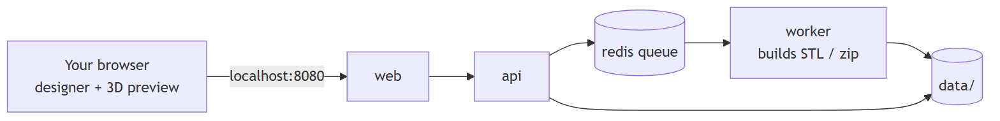

# Hex Set Studio

**Design your own 3D-printable board set for Catan, then export every part as an STL.**

Hex Set Studio comes with the real measurements of the base game's components built in. You customize how each piece looks, arrange your tiles on a 3D board, and download print-ready files. It runs entirely on your own computer.

> 🚧 **Status: early development (Phase 0: foundations).** The app isn't usable yet. This README describes v1 as planned. Follow along in the [roadmap](ARCHITECTURE.md#roadmap).

## Features (v1)

- **True-to-size pieces:** terrain hexes (79 × 89 mm), number chits (Ø25 mm), ports, roads, settlements, cities, the robber and dice, all at real dimensions. Cards are optional.
- **3D piece designer:**
  - silhouette presets
  - embossed or engraved text and icons
  - reliefs generated from an image
  - chamfers and hollow undersides
  - fit tolerances
  - a live 3D preview with a millimeter grid
- **3D board builder:** place hexes, chits and ports, or randomize with fairness rules (no adjacent 6s and 8s), and see the pip statistics.
- **Print-ready export:** one STL, or **Export All** as a zip organized by part, with a manifest of how many copies to print. Every mesh is checked to be watertight, with walls thick enough to print.
- **Private by design:** no account, no cloud. Projects auto-save in your browser and can be shared as zip files.

## Quick start

**You need:** [Git](https://git-scm.com) and [Docker Desktop](https://docs.docker.com/get-docker/) (or Docker Engine with Compose v2). Nothing else.

```bash
git clone https://github.com/pH-li/catan-board-maker.git
cd catan-board-maker
docker compose up
```

Then open **http://localhost:8080**.

| Task | Command |
|---|---|
| Stop | `Ctrl+C`, or `docker compose down` |
| Run in the background | `docker compose up -d` |
| Update to the latest version | `git pull && docker compose up --build` |
| Uninstall (removes all app data) | `docker compose down -v`, then delete the folder |

**Your files:** exports and uploads are stored in the `data/` folder inside the project and removed automatically after 24 hours. Your designs are saved in your browser. Use **Export project** to keep a backup or share a design.

> 🔒 The app is only reachable from your own computer (`127.0.0.1`). Don't expose it to the internet or your local network; it isn't designed for that. See [ARCHITECTURE.md → Security](ARCHITECTURE.md#security).

## How it works



A design is a set of parameters. The same TypeScript geometry code builds the live preview in your browser and the final STL in the background worker, so **what you see is exactly what prints**. Details are in [ARCHITECTURE.md](ARCHITECTURE.md).

## Tech stack

| Area | Choice |
|---|---|
| Language | TypeScript everywhere (pnpm monorepo) |
| Frontend | React, Vite, react-three-fiber + drei, Tailwind CSS + shadcn/ui, Zustand, TanStack Query |
| Geometry | Parametric builders, manifold-3d (WebAssembly), binary STL |
| Backend | Express 5, Zod, BullMQ + Redis |
| Runtime | Docker Compose |
| Quality | Vitest, React Testing Library, Supertest, Playwright, fast-check, ESLint, Prettier, GitHub Actions, CodeQL, Trivy, gitleaks |

Every choice has a written rationale in [ARCHITECTURE.md → Design decisions](ARCHITECTURE.md#design-decisions).

## Repository layout

```
apps/
  web/              React UI, 3D viewer, project storage
  api/              Express API + BullMQ worker
packages/
  specs/            component dimensions + counts (single source of truth)
  schemas/          Zod schemas shared by web and api
  geometry/         pure mesh builders + STL writer
docs/images/        screenshots and diagrams used by the docs
ARCHITECTURE.md     system design, decisions, security, testing
CONTRIBUTING.md     dev setup, workflow, coding standards
AGENTS.md           instructions for AI coding agents
```

## Contributing

Contributions are welcome! Start with [CONTRIBUTING.md](CONTRIBUTING.md) for the dev setup, workflow and standards. AI coding agents should read [AGENTS.md](AGENTS.md). Found a security issue? Please report it privately (see [ARCHITECTURE.md → Reporting a vulnerability](ARCHITECTURE.md#reporting-a-vulnerability)).

## Roadmap

v1 covers the **base game**. Expansion components (city walls, knights, ships, the merchant, metropolis and barbarian ship pieces, harbor randomizers, bonus chits) are planned for later. Their measurements are already recorded.

**Not planned:** importing your own CAD/STL models, user accounts, or a hosted website.

## License and disclaimer

[MIT](LICENSE) © 2026 Lily Phan

Hex Set Studio is an independent fan project. It is **compatible with** CATAN® but **not affiliated with, endorsed by, or sponsored by** CATAN GmbH, CATAN Studio, or any of their partners. CATAN is a registered trademark of CATAN GmbH. This project contains no official artwork or assets; all designs are created by users.
