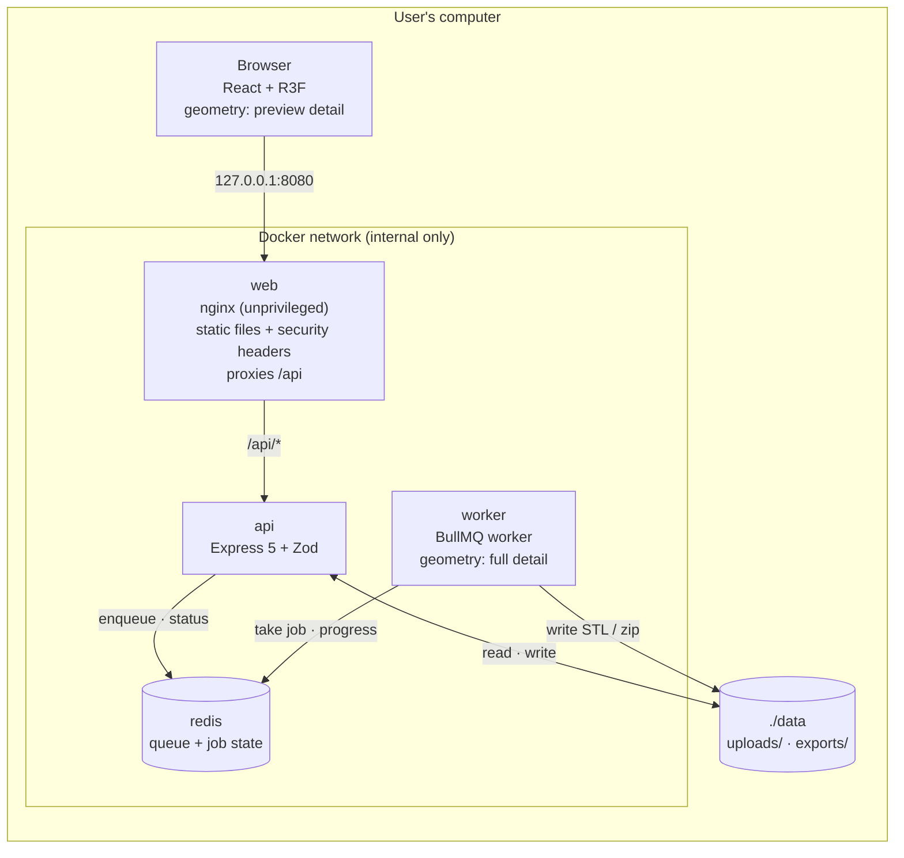
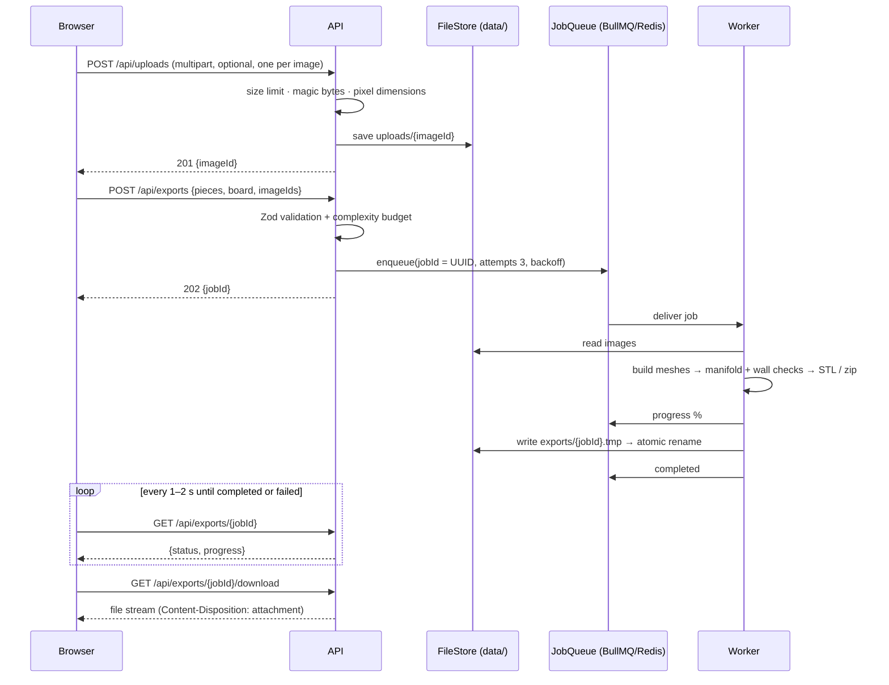
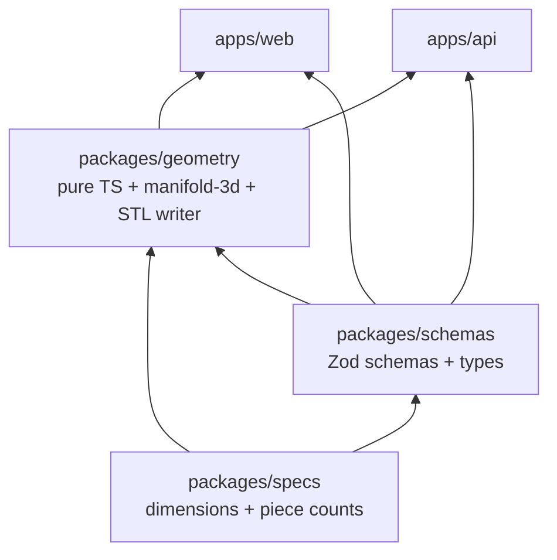
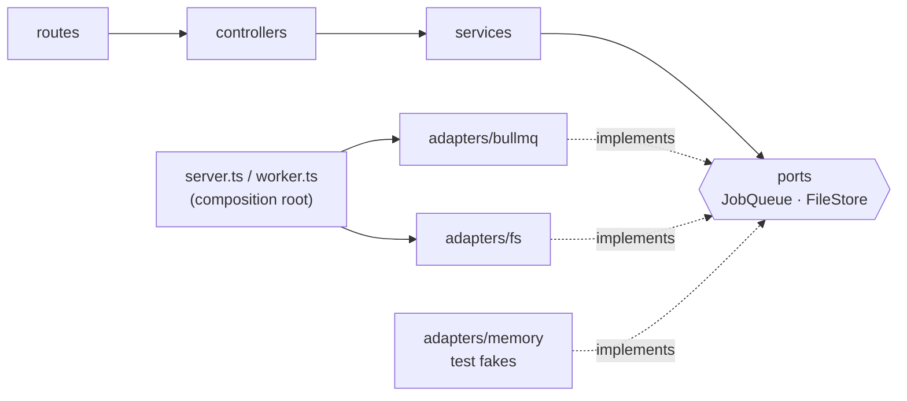
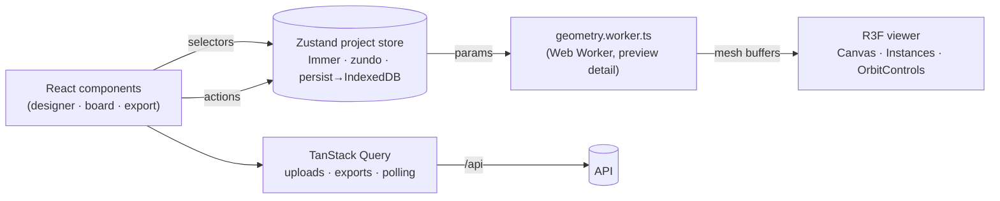

# Architecture

> **Status:** this describes the target architecture for v1. It's being built in phases (see [the roadmap](#build-roadmap)). The reasoning behind each choice lives in the [ADRs](adr/README.md).

## 1. What the system does

Hex Set Studio turns **design parameters** into **3D-printable STL files** for a Catan-compatible board set.

```
design parameters (JSON)  ──►  geometry builders  ──►  triangle mesh  ──►  3D preview  /  STL file
{ piece: "settlement",          buildSettlement()       vertices +          (browser)     (export)
  roof: "gabled", ... }                                  triangles
```

The same geometry code produces both the live preview and the exported file, so **the preview always matches the print** ([ADR 0001](adr/0001-typescript-everywhere.md)).

## 2. Runtime view

What `docker compose up` starts on a user's machine:



| Service | Responsibility | Published? |
|---|---|---|
| `web` | Serves the built React app; reverse-proxies `/api`; sets CSP and other headers | **Yes, `127.0.0.1:8080` only** |
| `api` | Validates requests, stores uploads, enqueues jobs, reports status, streams downloads | No |
| `worker` | Builds meshes at full detail, validates them, writes STL/zip, reports progress | No |
| `redis` | BullMQ queue and job state (`noeviction`, AOF persistence) | No |

`api` and `worker` share one image and one codebase (`apps/api`) with two entry points.

## 3. Export flow



**Reliability properties:**
- **Idempotent enqueue:** the `jobId` is the BullMQ job ID, so a duplicate submit doesn't create duplicate work.
- **At-least-once processing:** a crashed worker's job is retried (3 attempts, exponential backoff). Exhausted jobs stay in the failed set, which serves as the dead-letter queue.
- **Atomic output:** write to `.tmp`, then rename, so a partially written file is never served.
- **Retention:** jobs and files are removed after 24 h by BullMQ options and an hourly cleanup scheduler.

## 4. Code structure

### Packages


| Package | Contains | Must not contain |
|---|---|---|
| `packages/specs` | Component dimensions (mm), piece counts, expansion flags | Logic beyond constants and simple helpers |
| `packages/schemas` | Zod schemas, inferred types, OpenAPI registry, limits | I/O |
| `packages/geometry` | Pure builders `build<Piece>(params, detail)`, CSG features, validation, STL writer | DOM, React, Node I/O, Redis |
| `apps/web` | UI, viewer, stores, API client, Web Worker host | Duplicated geometry or schemas |
| `apps/api` | HTTP API, worker, ports and adapters | Geometry logic (it calls `packages/geometry`) |

### Backend layers (ports and adapters)

- Controllers handle HTTP only. Services hold the business logic and depend on **ports**, never on adapters ([ADR 0014](adr/0014-ports-and-adapters.md)).
- `LocalFileStore` is the **only** code that touches the filesystem, and it confines every path to `DATA_DIR`.
- `config.ts` parses environment variables with Zod at startup, so misconfiguration fails fast.

### API surface (v1)

| Method | Path | Purpose |
|---|---|---|
| `GET` | `/api/health` | API and Redis health |
| `POST` | `/api/uploads` | Upload one image (multipart, ≤5 MB, PNG/JPEG/SVG) → `{ imageId }` |
| `POST` | `/api/exports` | Create an export job → `202 { jobId }` |
| `GET` | `/api/exports/:jobId` | `{ status, progress, error? }` |
| `GET` | `/api/exports/:jobId/download` | Stream the finished file |
| `GET` | `/api/docs` | Generated OpenAPI documentation |

## 5. Frontend



- **Project state** (Zustand) holds design parameters and the board layout. Components subscribe through selectors, so a slider drag re-renders only what depends on it ([ADR 0011](adr/0011-state-management.md)).
- **Geometry runs off the main thread** in a Web Worker. The UI stays responsive, and finished buffers are handed to three.js.
- **Server state** (TanStack Query) handles uploads, export creation and status polling.
- **Persistence:** auto-save to IndexedDB, plus manual project zip export and import. Imports are validated ([threat model](THREAT_MODEL.md)).

## 6. Environments

| | Users | Contributors |
|---|---|---|
| Start | `docker compose up` | `docker compose -f docker-compose.dev.yml up -d` + `pnpm dev` |
| Frontend | nginx on `127.0.0.1:8080` | Vite on `localhost:5173` (proxies `/api` → `:3000`) |
| API / worker | containers | `tsx watch`, reloads on save |
| Redis | internal container | container on `127.0.0.1:6379` |
| Data | `./data` volume | `./data` (configurable with `DATA_DIR`) |

## 7. Key invariants

1. **Millimeters only.** Every physical dimension comes from `packages/specs`.
2. **Geometry is pure and deterministic:** the same parameters and detail level always produce the same mesh.
3. **Validate at every trust boundary** with the shared Zod schemas: API requests, job payloads, imported projects, environment config.
4. **Only server-generated identifiers touch the filesystem.**
5. **Nothing listens beyond `127.0.0.1`.**
6. **Preview and export use the same builders**, differing only in `detail`.

## Build roadmap

| Phase | Scope |
|---|---|
| 0 | Docs, decisions, tooling, CI |
| 1 | Specs, schemas, base geometry for all v1 pieces, designer viewer |
| 2 | API, uploads, BullMQ export pipeline, security middleware, full Docker stack |
| 3 | Silhouette presets, text, icons, emboss and engrave |
| 4 | 3D board builder, randomizer, Export All + manifest |
| 5 | Heightmaps, multi-color split, print plates, image tracing, project zip import/export |
| 6 | E2E tests, polish, v1.0.0, optional GHCR images |
