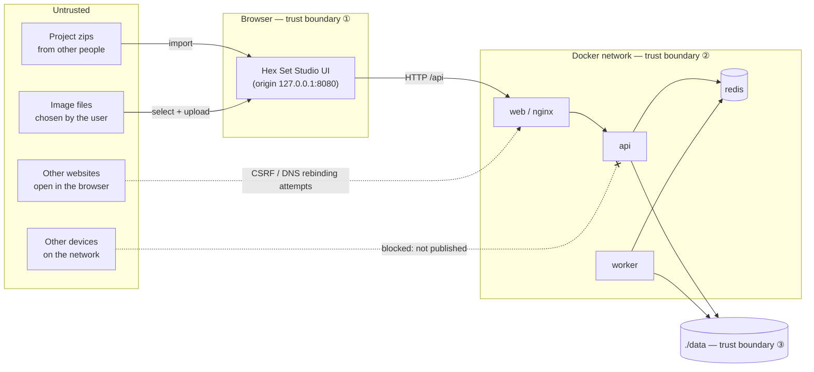

# Threat Model

> Review this document whenever you add an **input**, an **endpoint**, a **service**, a **new kind of file handling**, or a **new dependency category**. The PR template asks about it.

## 1. Scope

Hex Set Studio v1 as documented: a single-user app that runs on the user's own computer through Docker Compose, reachable at `http://127.0.0.1:8080`. There are no accounts and no cloud services ([ADR 0010](adr/0010-no-accounts.md), [ADR 0013](adr/0013-local-docker-distribution.md)).

**Out of scope:** running the app on a public network or the internet. That's unsupported and would need a new threat model.

## 2. Assets

| Asset | Why it matters |
|---|---|
| **The user's computer**: files outside `data/`, CPU, memory, disk | The app must never become a way to read or write arbitrary files, or to exhaust the machine |
| **The user's designs**: browser storage, `data/` | Loss or tampering wastes work |
| **Integrity of the code and images users run** | A compromised dependency, image or CI pipeline would run on every user's machine |
| **Availability of the app** | Lower priority, since the user can restart it |

There is no personal data and there are no production secrets.

## 3. Data flow and trust boundaries



- **① Browser:** imported zips and selected images enter the app here. Everything is validated before use.
- **② API edge:** every HTTP request is untrusted, even from our own UI, because any website or local program can send requests to localhost.
- **③ Filesystem:** only server-generated identifiers ever become paths, confined to `DATA_DIR`.

## 4. Entry points

| Entry point | Input |
|---|---|
| `POST /api/uploads` | Multipart image file |
| `POST /api/exports` | JSON design parameters + image IDs |
| `GET /api/exports/:jobId`, `/download` | URL parameter |
| Project zip import (browser) | Zip archive → `project.json` + images |
| Environment config | `.env` / Compose variables |
| Dependencies, base images, GitHub Actions | Third-party code |

## 5. STRIDE analysis

| Category | Threat | Mitigation | Verified by |
|---|---|---|---|
| **S**poofing | A malicious website sends requests to `localhost:8080` pretending to be the app (**CSRF**) | `originGuard`: reject state-changing requests whose `Origin` isn't the app's origin. JSON endpoints require `application/json` (forces a CORS preflight, which fails because no CORS headers are sent) | Middleware unit tests; integration tests send a foreign `Origin` → 403 |
| **S**poofing | **DNS rebinding**: an attacker's domain re-resolves to `127.0.0.1` so the attacker's page can read API responses | `originGuard` rejects any `Host` other than `localhost`/`127.0.0.1` with the expected port | Integration test: `Host: evil.example` → 403 |
| **T**ampering | **Path traversal** through IDs (`../../etc/passwd`) | Zod validates IDs as UUIDs; filenames are server-generated; `LocalFileStore` resolves paths and asserts they stay inside `DATA_DIR` | Unit and integration tests with traversal payloads → 400 |
| **T**ampering | **Zip slip** in imported project zips (entries named `../x` or absolute paths) | Import runs in the browser with no filesystem writes; entry names are allow-listed (`project.json`, `images/<uuid>.<ext>`); everything else is rejected | Component tests with crafted zips |
| **T**ampering | A malicious `project.json` (unexpected shapes, extreme values) | Zod schema with limits; versioned migrations; unknown keys stripped | Schema unit tests + fast-check |
| **T**ampering | **Supply chain**: a compromised npm package, base image or GitHub Action | Frozen lockfile; pnpm build-script allow-list; Dependabot; `pnpm audit`; CodeQL; images pinned by digest; Trivy scan; actions pinned to SHAs; read-only workflow permissions; branch protection | CI jobs |
| **R**epudiation | Hard to tell what happened when an export fails | Structured logs with `requestId` and `jobId` (no user content); failed jobs keep their error reason in BullMQ | Log format tests |
| **I**nformation disclosure | Other devices on the network reach the API or Redis | Only `web` is published, on `127.0.0.1`; Redis, the API and the worker aren't published; the dev Redis binds to `127.0.0.1` | Compose config review; manual LAN check |
| **I**nformation disclosure | Stack traces or internal paths in error responses | A central error handler returns a generic message + `requestId`; `x-powered-by` off; `helmet` | Integration tests assert there's no stack in a 500 body |
| **I**nformation disclosure | **XSS** through user text or SVGs runs scripts in the app's origin | React escaping; `dangerouslySetInnerHTML` banned by a lint rule; user text becomes geometry, not HTML; SVGs parsed for path data only, DOMPurify before any display; strict CSP | Lint rule; component tests; CSP header test |
| **I**nformation disclosure | **Clickjacking** (the app framed by another site) | `frame-ancestors 'none'` | Header test |
| **D**enial of service | Expensive export requests (many pieces, maximum-resolution reliefs) | Zod limits on every field plus a total **complexity budget**; worker concurrency 2; job timeout; container memory and CPU limits; Node heap limit | Unit tests for the budget; integration test for the timeout |
| **D**enial of service | **Decompression bombs**: tiny images that decode to huge bitmaps | Read image headers and reject over 4096 × 4096 *before* decoding; ≤5 MB uploads | Unit tests with crafted headers |
| **D**enial of service | **Zip bombs** on project import | Before extracting, check the central directory: ≤100 MB total uncompressed, ≤500 entries, a per-entry compression-ratio cap | Component tests with crafted zips |
| **D**enial of service | Disk fills up with old exports | 24 h retention through BullMQ options and an hourly cleanup scheduler | Integration test for the cleanup |
| **E**levation of privilege | A container compromise affects the host | Non-root users; read-only root filesystem where possible; only `data/` writable; no Docker socket mounted; production dependencies only | Dockerfile review; Trivy |
| **E**levation of privilege | Fake file types (a script renamed `.png`) | Magic-byte detection; allow-listed types only; downloads use `Content-Disposition: attachment` | Unit tests |

## 6. Security headers (nginx, proposed)

Verify these once the real frontend exists in Phase 2. Every relaxation needs a justification comment in `nginx.conf`.

```
Content-Security-Policy:
  default-src 'self';
  script-src 'self' 'wasm-unsafe-eval';   # manifold-3d WebAssembly
  style-src 'self' 'unsafe-inline';       # Radix/R3F set inline style attributes
  img-src 'self' data: blob:;             # local image previews
  worker-src 'self' blob:;                # geometry Web Worker
  connect-src 'self';
  object-src 'none';
  base-uri 'none';
  form-action 'self';
  frame-ancestors 'none'
X-Content-Type-Options: nosniff
Referrer-Policy: no-referrer
Permissions-Policy: camera=(), microphone=(), geolocation=()
```

HSTS isn't used, because the app is served over plain HTTP on localhost by design.

## 7. Residual risks (accepted)

| Risk | Why it's accepted |
|---|---|
| Other programs running on the same computer can call the API directly | They already run with the user's privileges, so the app adds no new capability |
| A user deliberately publishes the app beyond localhost | Unsupported; documented in SECURITY.md and the README |
| `style-src 'unsafe-inline'` | Needed by the UI libraries; script execution is still blocked |

## 8. Review checklist (for PRs)

- [ ] Does this add or change an input? Is it validated with a Zod schema **with limits**?
- [ ] Does any user-influenced value reach a file path, shell, query or HTML? (It shouldn't.)
- [ ] Does it add a port or service? Is it bound to `127.0.0.1` or internal only?
- [ ] Does it add a dependency? Is it maintained and needed, and does it run install scripts?
- [ ] Do errors stay generic in responses?
- [ ] Is this document updated?
